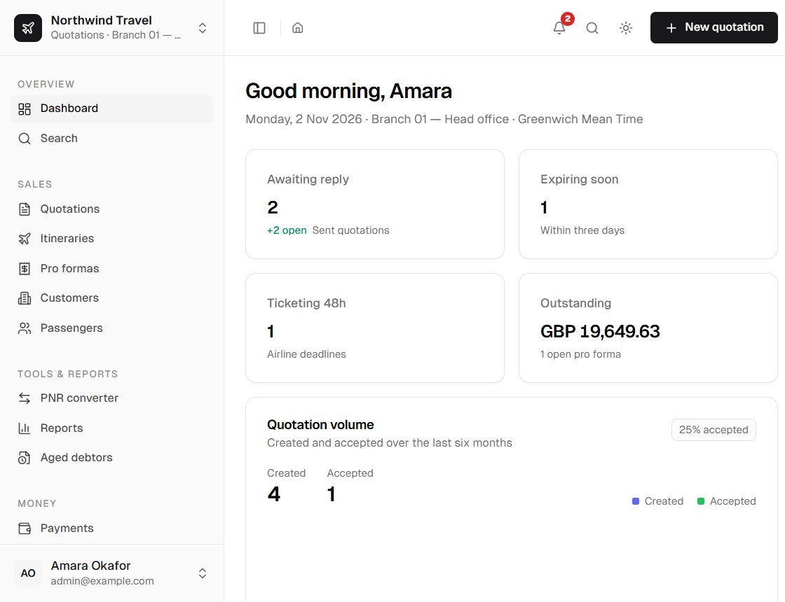
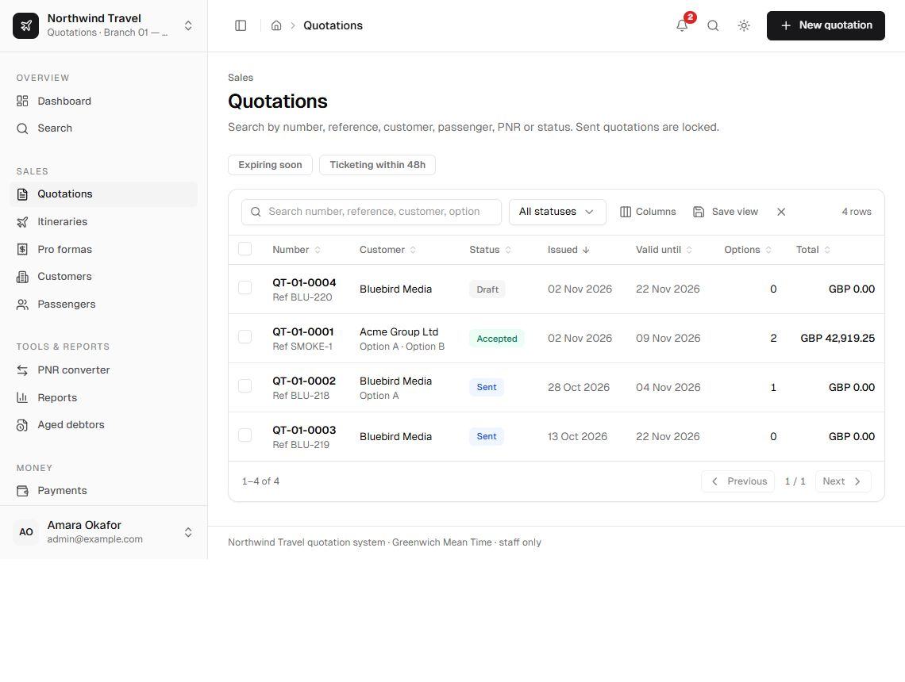
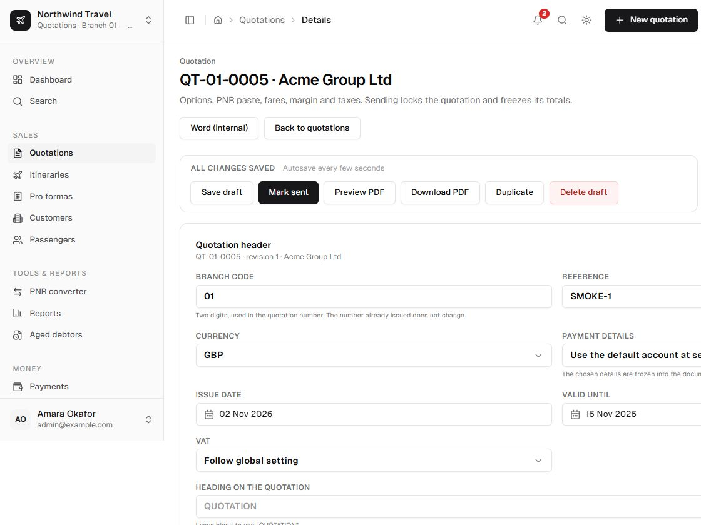
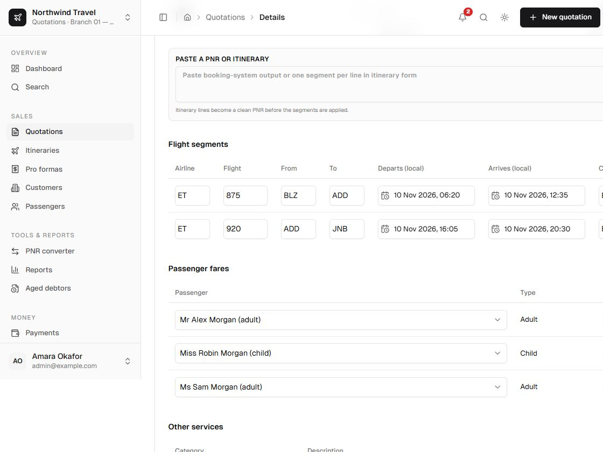
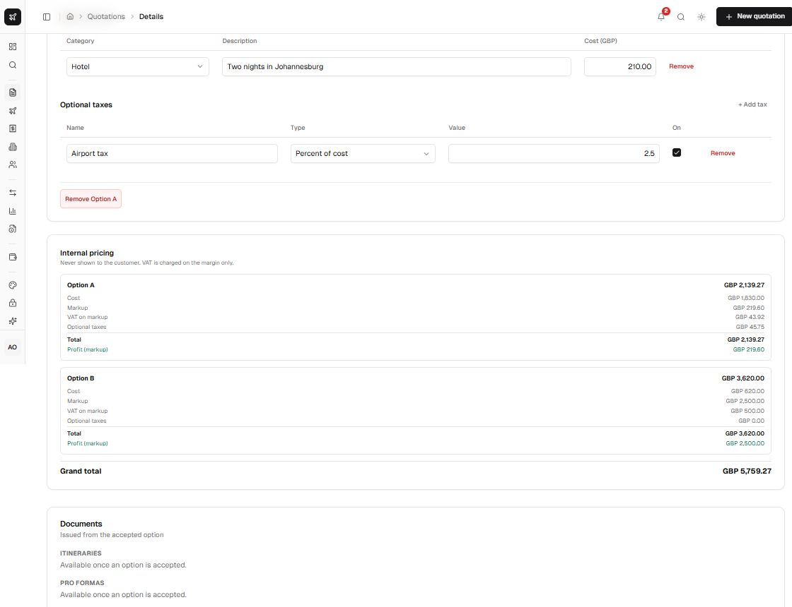
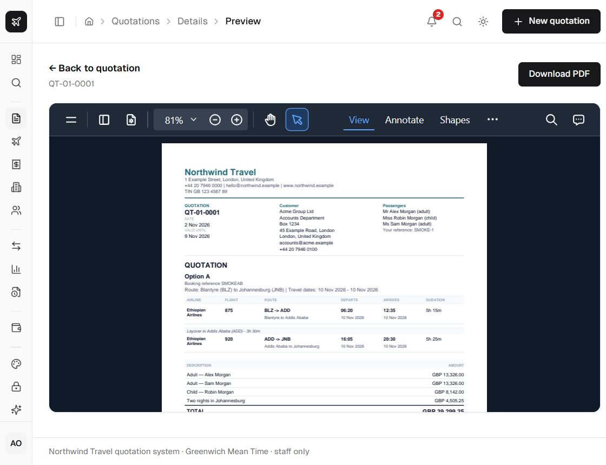
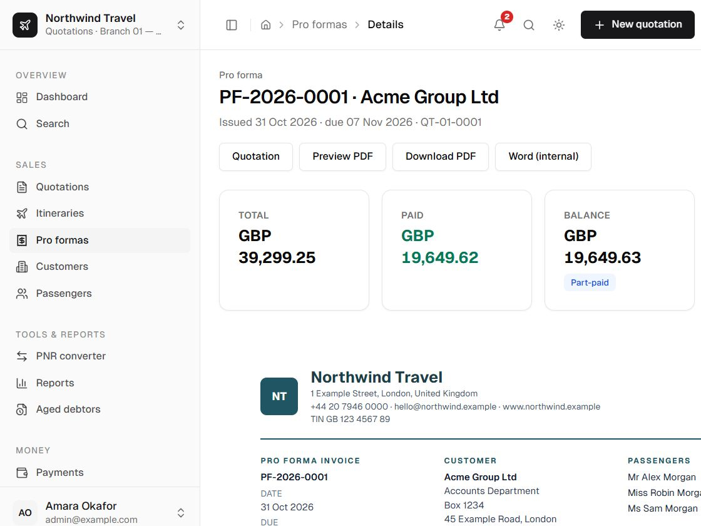
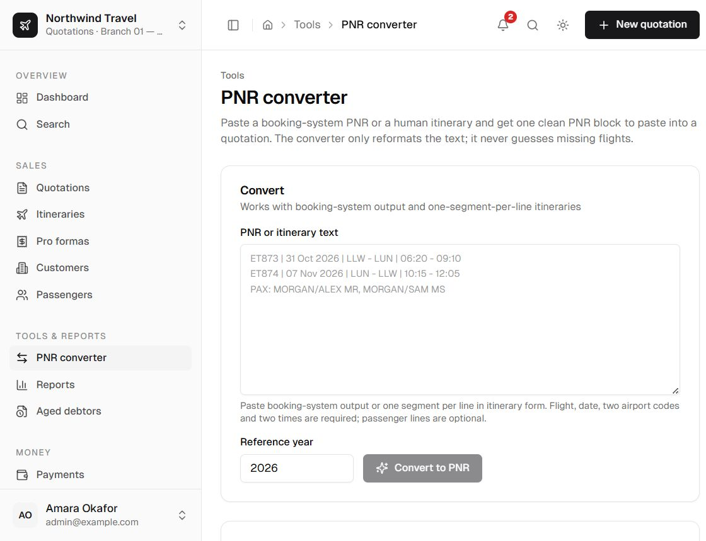
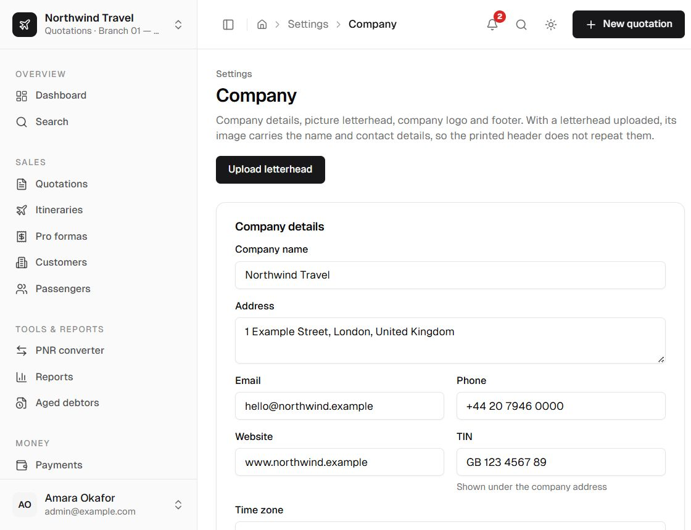
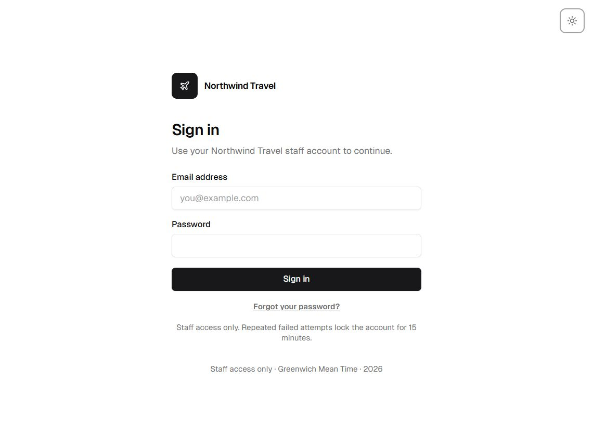

# Trasper

Trasper is a staff-only quotation and pro forma system for travel agencies. Build branded journeys from a pasted PNR or from scratch, add named passengers or traveller groups, issue an itinerary and a pro forma invoice, then record and reconcile payments. Itineraries can also be created standalone — by hand or from pasted text — when no quotation or pricing is needed.

Built with Next.js (App Router), TypeScript, Prisma, SQLite, Zod, Tailwind, Luxon and a pure integer pricing engine. Licensed under the [MIT Licence](LICENSE).

[](https://github.com/yehoshu1/trasper/actions/workflows/ci.yml)
[](LICENSE)

## Screenshots

The screenshots use **Northwind Travel**, a fictional agency used for the demo.

### Dashboard



### Quotations



### Quotation editor





Cost, markup, VAT and profit are visible to staff and never sent to the customer:



### Customer document



### Pro forma and payments



### PNR converter



### Agency settings



### Sign in



## Features

- **Configurable branding.** Manage the agency's name, address, contact details, website, tax ID, footer, logo, picture letterhead and time zone from Settings. Each document can print either the picture letterhead or the typed company details with the logo; the TIN is always printed separately from a picture letterhead. Printed documents use the saved profile.
- **Quotations with additive journeys.** A quotation can contain one or more separately priced journeys, each with its own PNR, flights, named passengers or traveller groups, cost lines, exchange rate, margin and optional taxes. Journey totals add to one quotation total, and accepting the quotation includes every journey.
- **Quote before or after booking.** Flights can be entered by hand, so a quotation can be priced and sent before a PNR exists. Named passengers and unnamed traveller groups (for example **2 Adults**) are both supported.
- **PNR conversion.** Amadeus, Sabre and Galileo-style output plus free-form itineraries are parsed deterministically. Unreadable input is reported for manual entry; the parser never guesses. AI conversion is an optional fallback, with the provider key encrypted at rest.
- **Internal pricing, customer-safe documents.** Money is integer minor units. Cost, markup and VAT live in staff views only, and viewers never receive them. Agencies choose how customers see price: one all-inclusive amount per line (the default), supplier price plus a separate service fee, a fully itemised cost/fee/tax layout, a per-person package price or a single total. Every layout is generated from the same calculation and the rows always add up exactly to the total.
- **Frozen issued documents.** Sending a quotation locks it and freezes the rate, VAT settings, totals and company snapshot. Itineraries and pro formas are frozen too. Later setting or reference-data changes never alter them.
- **Quotation-linked or standalone itineraries.** An itinerary can be issued from an accepted quotation with all its journeys, or created standalone with its own customer, passengers and flights. Standalone itineraries can be built from a pasted PNR or entered flight by flight, and carry no prices, quotation link or pro forma; pro formas still require an accepted quotation.
- **Electronic ticket records.** Paste airline `TKT:` blocks or `*HTE` ticket lists, store 13-digit ticket numbers and coupons, link them to a customer or quotation, and print a ticket itinerary receipt. Airlines issue the tickets; Trasper records them.
- **Print-ready documents.** Five quotation/pro forma templates and a dedicated itinerary layout, shown on screen and rendered into PDFs from the same frozen snapshot. PDFs are generated server-side with `pdf-lib`; no headless browser is needed at runtime.
- **Append-only payments.** Payments can be reversed but never edited or deleted. Pro forma status is derived: unpaid, part-paid, paid or cancelled.
- **Role-based access.** Admin, agent, accountant and viewer roles, plus editable custom roles built from capabilities. Viewers never receive cost, markup or profit data from the server.
- **Audit and history.** Every write is audited, with a per-record timeline for calls, emails, notes, WhatsApp messages, meetings and follow-ups.
- **Operations.** SQLite with WAL mode, automatic migrations in Docker, a guarded cron route for quotation expiry and payment-status rollups, CSV exports, aged debtors, backups and a health endpoint.
- **Themes.** Eleven colour palettes with a custom theme builder and light/dark/system appearance.

## How the app is structured

Trasper is one Next.js App Router application. The marketing site, staff workspace, documentation and HTTP endpoints are served by the same process and ship in the same container. There is no separate frontend service, API server or database server.

| Surface | Route | Implementation |
| --- | --- | --- |
| Public landing page | `/` | `src/app/page.tsx`, `src/app/landing.module.css`, `public/screenshots/` |
| Staff dashboard | `/dashboard` | `src/app/(staff)/dashboard/page.tsx` inside the authenticated `(staff)` shell |
| Staff workspace | `/quotations`, `/customers`, `/itineraries`, `/proformas`, `/payments`, `/reports`, `/settings/...` | `src/app/(staff)/`; every page checks session and capability |
| Sign-in and 2FA | `/login`, `/login/2fa`, `/enrol-2fa` | `src/app/login/`, `src/app/enrol-2fa/` |
| Documentation | `/docs` | Fumadocs pages compiled from `content/docs/`, rendered by `src/app/docs/` |
| HTTP endpoints | `/api/...`, `/docs/api/search` | `src/app/api/`, `src/app/docs/api/search/route.ts` |

**Frontend.** React server components and Tailwind 3 under `src/app` and `src/components`; shared A4 print templates under `src/documents`. The public landing page is separate from the authenticated shell: `/` needs no session, while `/dashboard` and the staff routes do.

**Backend.** Every write is a server action under `src/server/actions`: capability check, Zod validation, domain checks, then the write and audit row in one transaction. Prisma talks to a local SQLite file (WAL mode) through `src/server/db.ts`. Auth, roles, settings, numbering, document snapshots, PDFs, Word export, AI PNR fallback and scheduled jobs live in `src/server`. The route handlers in `src/app/api` are limited to reads, uploads, downloads, auth, health and cron.

**Docs.** The user and developer guides are MDX in `content/docs`, compiled by Fumadocs into the same Next.js build at `/docs`. They are public and have no separate search service.

**Deployment.** A multi-stage `Dockerfile` builds the Next.js standalone output on Node 24. Production Compose runs the published GHCR image, a cron container and Caddy for HTTPS; SQLite, uploads and backups sit on persistent volumes. The development Compose stack builds `Dockerfile.dev`, bind-mounts the repository and runs `next dev`. See [Docker](#docker) below.

## Requirements

- Node.js **24** or later (the Prisma SQLite adapter requires it).
- npm.
- For Docker: Docker Engine with Compose, and a persistent volume.
- Optional: a Resend account for 2FA, password-reset and invite email; an OpenAI-compatible endpoint for AI PNR fallback.

## Quick start

```bash
git clone https://github.com/yehoshu1/trasper.git
cd trasper
cp .env.example .env
```

Edit `.env` and set at least:

```dotenv
AUTH_SECRET="<openssl rand -base64 48>"
ADMIN_EMAIL="you@agency.example"
ADMIN_PASSWORD="<a strong password>"
APP_TIMEZONE="Europe/London"       # or your IANA zone
BASE_CURRENCY="GBP"                # or your currency
```

Then install, migrate, seed and run:

```bash
npm install
npm run db:generate
npm run db:deploy
npm run db:seed
npm run dev
```

Open <http://localhost:3000> to see the product landing page, then choose **Staff sign in** and use `ADMIN_EMAIL` / `ADMIN_PASSWORD`. Change the password after the first sign-in, then complete **Settings → Company**.

`npm run db:seed` is idempotent. It creates the first admin, roles, currencies, airlines, airports, the first branch and neutral company settings. It does not create bank accounts — add your agency's accounts under **Settings → Bank accounts**.

### Try it with demo data

```bash
node scripts/smoke-quotation.mjs    # one draft quotation with two journeys
node scripts/smoke-documents.mjs    # accepts it, issues an itinerary and part-paid pro forma
node scripts/create-viewer.mjs      # viewer@example.com for the cost-redaction check
```

## Configuration

### Environment variables

These are deployment values, not agency branding. Copy `.env.example` and set what you need.

| Variable | Purpose |
| --- | --- |
| `DATABASE_URL` | SQLite file, e.g. `file:./data/app.db`. In Docker: `file:/data/app.db`. |
| `APP_URL` | Public origin used for cookies, trusted origins and links. Must be `https://` in production. |
| `APP_DOMAIN` | Hostname for the bundled Caddy reverse proxy in `docker-compose.prod.yml`. |
| `APP_TIMEZONE` | Fallback IANA zone before settings are saved, e.g. `Europe/London`. |
| `AUTH_SECRET` | Session signing secret. At least 32 random characters in production. |
| `ADMIN_EMAIL` / `ADMIN_PASSWORD` | First admin created by the seed. Production rejects the published development default. |
| `UPLOAD_DIR` | Persistent directory for logos, avatars and attachments. |
| `RESEND_API_KEY` | Optional. Enables transactional system email. |
| `SYSTEM_FROM_EMAIL` | From address for system email. |
| `SYSTEM_FROM_NAME` | Optional override for the agency name in the From header. |
| `CRON_SECRET` | Bearer token for `/api/cron`. Required in production. |
| `BACKUP_DIR` | Local backup destination. |
| `BACKUP_REMOTE` | Optional rsync/mounted destination for off-server backups. |
| `AI_PROVIDER`, `AI_MODEL`, `AI_API_KEY` | Optional AI fallback defaults; the provider URL and key can also be saved in Settings → AI. |
| `APP_NAME` | Optional display name used before settings load, e.g. for the TOTP issuer. |
| `APP_PORT` | Optional host port for `docker-compose.dev.yml`; default `3000`. |
| `APP_IMAGE_REPO` | GHCR repository for the production stack, e.g. `ghcr.io/<owner>/<repo>`. |
| `APP_IMAGE_TAG` | Production image tag / release version, e.g. `0.1.0` or `sha-<commit>`. |
| `APP_REVISION` | Read-only commit SHA baked into the image; reported by `/api/health`. |
| `ACME_EMAIL` | Optional Let's Encrypt contact address for Caddy. |

Seed-only variables initialise a fresh database. Once an admin saves the corresponding setting, the database is the source of truth:

`SEED_COMPANY_NAME`, `SEED_COMPANY_ADDRESS`, `SEED_COMPANY_EMAIL`, `SEED_COMPANY_PHONE`, `SEED_COMPANY_WEBSITE`, `SEED_COMPANY_TIN`, `SEED_COMPANY_FOOTER`, `BASE_CURRENCY`, `VAT_ENABLED`, `VAT_RATE_BPS`, `VAT_REGISTRATION_NUMBER`, `VAT_LABEL`, `PRICING_ROUNDING_UNIT`, `PRICING_DEFAULT_MARGIN_BPS`, `PRICING_DEFAULT_VALIDITY_DAYS`, `PRICING_RATE_MAX_AGE_DAYS`, `PRICING_DISPLAY`, `PRICING_TAX_DISPLAY`, `SERVICE_FEE_LABEL`, `TAX_LABEL`, `TOTAL_LABEL`, `PER_PERSON_LABEL`, `TAX_NOTE`.

### Settings

Branding, tax, numbering and payment details are managed in the app:

| Settings page | What it controls |
| --- | --- |
| Company | Name, address, email, phone, website, TIN, document header (letterhead or company details), time zone, logo, picture letterhead, footer, internal notes, validity defaults and quotation validity statement |
| Pricing presentation | Default price layout, tax layout and customer-facing labels (service fee, tax, VAT/GST, total, per person) |
| Document templates | Classic, Modern, Minimal, Executive and Vivid layouts for quotations, itineraries and pro formas |
| VAT and taxes | VAT rate and registration, VAT/GST label, rounding unit, optional tax presets and their percentage base |
| Numbering | Quotation, itinerary and pro forma number formats with branch/year/sequence placeholders |
| Bank accounts | Multiple accounts, exactly one default, frozen details on issued documents |
| Currencies | Base currency and dated exchange rates |
| Branches | Office codes used in document numbers |
| Users / Roles | Staff accounts, branch assignment and capability-based permissions |
| Themes | Palette and appearance preference |
| AI | Optional OpenAI-compatible provider, model and encrypted API key |

## The workflow

1. **Customers and passengers.** Add a paying contact and link travellers, or import a CSV.
2. **New quotation.** Choose the customer, branch, currency and dates.
3. **Build journeys.** Add flights by hand or paste a PNR, add named passenger fares or traveller groups, set an exchange rate, margin and optional taxes. The editor recalculates as you type.
4. **Mark sent.** The quotation locks, freezes its totals and becomes the customer-facing document. Changes go through **Revise**, which supersedes the old revision.
5. **Accept the quotation.** Issue the itinerary and the pro forma with every journey included. A standalone itinerary can also be created without a quotation when no price is involved.
6. **Record payments.** Status is derived from receipts and reversals; it is never typed.

### Pricing rules

The pricing engine lives in `src/lib/pricing/` and is pure: no database, no I/O and no implicit clock.

- Money is `BigInt` in minor units. Exchange rates are integers scaled by 1,000,000; margins and VAT are basis points.
- Calculation order: convert cost lines at the option's stored rate → cost total → markup → **VAT on the markup only** → enabled optional taxes on cost, markup or subtotal as configured → total → round once at the end.
- VAT is never charged on cost or on other taxes.
- Markup, VAT and taxes are allocated proportionally across lines; the last line absorbs the rounding remainder. The line prices add up **exactly** to the total in every presentation layout.
- The customer-facing layout is configurable per quotation and by agency default: lump sum per line, supplier price plus a separate service fee, itemised cost/fee/tax, per-person price, or a single total. Taxes can be shown as included (hidden or with a note) or NOT included (one combined tax row or each tax itemised) before the total.
- Accommodation, tours, cruises and transfers can carry a quantity and unit (`3 nights`, `2 rooms × 3 nights`, `4 people`) and optional room/board details. This supports per-room, per-person and per-night hotel pricing without changing the underlying cost model.
- Internal views always show cost, markup, VAT, taxes, total and profit. A pro forma may show VAT explicitly when the agency is VAT-registered and the document requires it.

### Documents and numbering

- Quotations: `QT-01-0001` by default (`QT-{BRANCH}-{SEQ:4}`).
- Itineraries: `IT-2026-0001` by default.
- Pro formas: `PF-2026-0001` by default.
- Numbers come from the `Sequence` table inside the same transaction as the document and are never reused, even after cancellation.
- Document dates are calendar dates stored at UTC midnight and displayed in the configured agency time zone. Flight times are local wall-clock strings at each airport and are never converted; durations and layovers use IANA time zones through Luxon.

## Roles

| Role | Capabilities |
| --- | --- |
| Admin | Everything, including users, roles and settings |
| Agent | Contacts, passengers, quotations, itineraries, pro formas, costs |
| Accountant | Read documents, record/reverse payments, contacts, audit log, reports and CSV export |
| Viewer | Read documents only; cost, rate, margin and profit are removed server-side |

Permissions are enforced on every page, server action, API route and download. Hiding a button is never the control. Admins can edit roles and create additional capability sets under **Settings → Roles**.

## Docker

There are two Compose files. They are deliberately separate: development builds from source, while
production pulls the versioned GHCR image and never builds on the host.

### Development stack

```bash
cp .env.example .env
docker compose -f docker-compose.dev.yml up --build
```

This builds `Dockerfile.dev`, bind-mounts the repository for hot reload and runs `next dev` at
<http://localhost:3000>. Set `APP_PORT=3100` before the command if port 3000 is already in use. The
database, uploads and backups live in named volumes (`dev-data`, `dev-backups`). The container
reinstalls dependencies when `package-lock.json` changes; rebuild only when `Dockerfile.dev` changes:

```bash
docker compose -f docker-compose.dev.yml build
```

Reset all development data with `docker compose -f docker-compose.dev.yml down -v`.

### Production stack

```bash
cp .env.example .env
# Set AUTH_SECRET, ADMIN_PASSWORD, CRON_SECRET, APP_DOMAIN and ACME_EMAIL.
# The production stack derives APP_URL as https://<APP_DOMAIN>.
# Set APP_IMAGE_REPO and APP_IMAGE_TAG to the released image:
#   APP_IMAGE_REPO="ghcr.io/<owner>/<repo>"
#   APP_IMAGE_TAG="0.1.0"
docker compose -f docker-compose.prod.yml pull
docker compose -f docker-compose.prod.yml up -d
```

`APP_IMAGE_TAG` is the release tag without the leading `v`. Pin an exact version in production;
`latest` works but is not a stable deployment target. `APP_URL` must be the public `https://` origin;
the production Compose stack derives it from `APP_DOMAIN`, while bare-Node deployments set it
directly. The production stack contains:

- `app` — the published image; migrations run on start, then the idempotent seed.
- `cron` — calls the guarded `/api/cron` route every 15 minutes for quotation expiry and payment-status rollups.
- `caddy` — terminates HTTPS and renews certificates automatically.

State lives on volumes: the SQLite database and uploads (`app-data`), backups (`app-backups`), and Caddy's certificates. Replacing the container does not lose data.

Airline logos are part of `uploads/`, not the image, so a fresh `app-data` volume has none. Fetch
them once inside the running container, or upload them under **Settings → Airlines**:

```bash
docker compose -f docker-compose.prod.yml exec app node scripts/fetch-airline-logos.mjs
```

On Dokploy, use `docker-compose.dokploy.yml` instead: Dokploy's Traefik owns ports 80/443, so that
stack has no Caddy and joins the external `dokploy-network`.

### Image tags

Every push to `main` and every `v*` tag builds the image and publishes it to GHCR, but only after the verification and end-to-end jobs pass:

| Trigger | Image tags |
| --- | --- |
| push to `main` | `latest`, `main`, `sha-<commit>` |
| tag `v1.2.3` | `1.2.3`, `1.2`, `latest`, `sha-<commit>` |

Images target `linux/amd64` and bake in `APP_VERSION`, which `/api/health` reports. Private packages require `docker login ghcr.io`; make the package public in its GitHub package settings if anonymous pulls are intended.

### Versioning and releases

Trasper uses [Semantic Versioning](https://semver.org/). `package.json` is the single source of truth,
and a `vX.Y.Z` Git tag must match it — CI rejects a release tag that does not. The release script
updates `package.json`, `package-lock.json` and `CHANGELOG.md`, commits the result and creates an
annotated tag:

```bash
# From a clean main branch, with entries under [Unreleased] in CHANGELOG.md:
npm run release:patch   # or release:minor / release:major
git push --follow-tags
```

CI then verifies the tag, runs the full suite and publishes `ghcr.io/<owner>/<repo>:X.Y.Z` (plus
`X.Y`). Deployments should set `APP_IMAGE_TAG` to that exact released version.

### Backups

```bash
npm run backup
# or, on the production stack:
docker compose -f docker-compose.prod.yml exec -T app npm run backup
```

`VACUUM INTO` takes a consistent snapshot while the app is running, gzips it, copies uploads, prunes to 14 daily / 8 weekly / 12 monthly backups, and optionally copies to `BACKUP_REMOTE`.

Restore drill:

1. Stop the app.
2. Replace `/data/app.db` with the newest `app-*.sqlite3.gz` (gunzipped).
3. Restore `uploads-*.tar.gz`.
4. Start the app and check sign-in, one quotation print and `/api/health`.

Backups contain password hashes and customer data. Encrypt the destination and restrict access.

## Security

- Strong `AUTH_SECRET` and `CRON_SECRET` are required outside development; published example values are rejected.
- Passwords are hashed by Better Auth. Login, password reset, 2FA, AI conversion and document downloads are rate-limited.
- Uploaded images are validated by magic bytes; attachments are served only through an authorised route.
- CSV exports neutralise spreadsheet formula injection.
- Responses carry a nonce-based CSP, `nosniff`, frame denial, a strict referrer policy, COOP/CORP and Permissions-Policy headers. PDFium is self-hosted, so previews make no third-party requests.
- Issued documents are frozen snapshots; payments are append-only.
- Passport data is never stored. Contacts and passengers are archived, never deleted, once referenced by a document.

To report a vulnerability, follow [SECURITY.md](SECURITY.md). Do not open a public issue.

## Documentation

The user and developer guides are served by the application at
<http://localhost:3000/docs>. They are built with Fumadocs from `content/docs` and split into a
**User guide** (staff, administrators, operators) and a **Developer guide** (architecture, data,
HTTP routes, tests). Run `npm run docs:css` after upgrading `fumadocs-ui`; see
<http://localhost:3000/docs/developer/docs-site> for the wiring.

## Development

```bash
npm run dev          # Next.js dev server with webpack
npm run typecheck    # tsc --noEmit
npm run lint         # ESLint
npm test             # compiled unit suite on Node's test runner
npm run test:e2e     # Playwright browser suite
npm run build        # production build
npm run logos:fetch  # download airline logos into uploads/airlines/
```

The unit suite covers pricing invariants, PNR parsing fixtures, time-zone and daylight-saving handling, money parsing, permissions, locking, numbering, aged debtors, saved views, revision diffs, document snapshots and AI-schema validation. Every domain rule in the implementation notes has a test.

### Project layout

```text
Dockerfile              production image
Dockerfile.dev          development image with hot reload
docker-compose.dev.yml  development stack (builds Dockerfile.dev)
docker-compose.prod.yml production stack (pulls GHCR)
deploy/Caddyfile        production HTTPS reverse proxy
prisma/                 schema, migrations and reference data
src/app/page.tsx        public landing page at /
src/app/(staff)/        authenticated staff routes; dashboard at /dashboard
src/app/docs/           Fumadocs site at /docs
src/app/api/            health, auth, search, PDF/Word, uploads and cron routes
src/server/             actions, auth, audit, numbering, documents, jobs
src/lib/                pure helpers: pricing, pnr, time, money, schemas
src/documents/          print templates shared by preview and PDF
src/components/         UI components
content/docs/           MDX source for the user and developer guides
public/                 static assets, screenshots and generated docs CSS
scripts/                seed, backup, cron, dev entrypoint, versioning, smoke data, logo fetch
tests/                  unit tests and Playwright end-to-end tests
```

### Database changes

```bash
npm run db:migrate -- --name describe_the_change
npm run db:generate
```

Commit the schema change and the generated migration together. Do not edit applied migrations.

## Contributing

Read [CONTRIBUTING.md](CONTRIBUTING.md) before opening a pull request.

The short version: keep changes focused, preserve the money/pricing invariants, add tests for domain rules, and never commit secrets, real customer data or passport details.

## Licence

[MIT](LICENSE) © 2026 Trasper contributors.

The demo screenshots use fictional names, addresses, bank details and flight data. Airline and airport reference data is factual and is not affiliated with any carrier.
