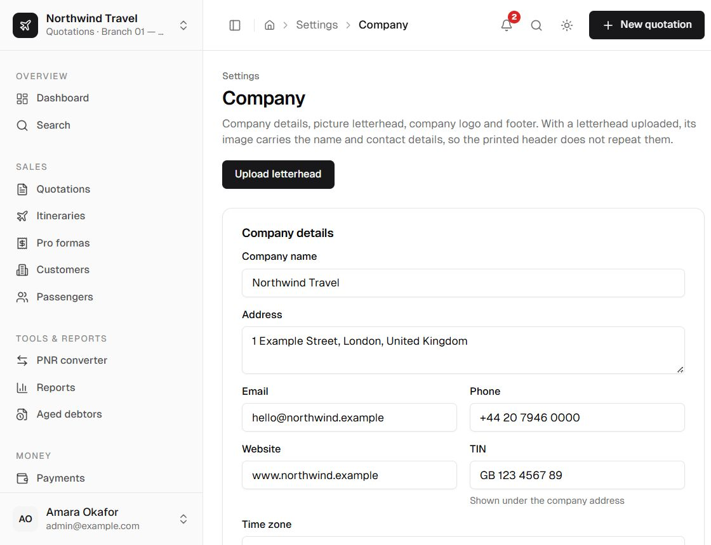

**Settings → Company** holds the agency identity used on every document and in the application shell.
Nothing here is compiled into the source; a fresh installation starts neutral.

  

## Identity

| Field | Printed or used for |
| --- | --- |
| Company name | Header, sidebar, email subjects, reports, Word metadata, PDF metadata. |
| Address | Document header. |
| Email, phone, website | Document header and contact block. |
| TIN | Printed as its own line, separate from a picture letterhead. |
| Footer line | Bottom of every printed document. |
| Internal notes | Never printed; a staff reminder. |
| Time zone | Document dates, deadlines, report boundaries and display. |

The time zone accepts an IANA name such as `Europe/London`, `Africa/Blantyre` or `America/New_York`.
Invalid values fall back to `APP_TIMEZONE`, then `UTC`.

## Document header

Choose one:

- **Picture letterhead** — print the uploaded letterhead image across the top. The TIN is still
  printed separately.
- **Company details and logo** — print the typed name, address, contacts, TIN and logo.

If a picture letterhead is selected but no image exists, documents fall back to company details.
Snapshots created before the setting existed keep their original behaviour.

## Images

- **Company logo** — PNG or JPEG, max 2 MB. Used in the sidebar, company-details header and sign-in.
- **Picture letterhead** — PNG or JPEG, max 2 MB.

Uploads are validated by magic bytes, not just the file extension. Stored files live under
`UPLOAD_DIR` and are served through authorised routes. The logo is public because it appears on the
sign-in screen; every other upload is staff-only.

## Commercial defaults

| Setting | Effect |
| --- | --- |
| Base currency | Default for new quotations and dashboard totals. Reports show each document's own currency. |
| Default margin (%) | Pre-fills new quotation options; stored as basis points. |
| Quotation validity (days) | Default validity period for new quotations and revisions. Defaults to 1 day. |
| Warn when a rate is older than (days) | Warning threshold for exchange rates. |
| Ticketing warning window (hours) | Dashboard, notification and send-warning window. |
| Payment terms | Default pro forma terms. |
| Standard quotation notes | Used when a quotation has no notes. |
| Quotation validity statement | Printed below the options and frozen when the quotation is sent. |
| Show flights on pro forma | Whether the pro forma includes the flight summary. |

## Related settings

- [Pricing presentation](/docs/user/administration/pricing-presentation)
- [VAT and taxes](/docs/user/administration/vat-and-taxes)
- [Document templates](/docs/user/administration/templates)
- [Numbering](/docs/user/administration/numbering)
- [Bank accounts](/docs/user/administration/banks)

## Permission and audit

`manageSettings` is required. Each save writes an audit entry with the before and after values for
only the fields the form owns. The encrypted AI key is never copied into the audit log.
