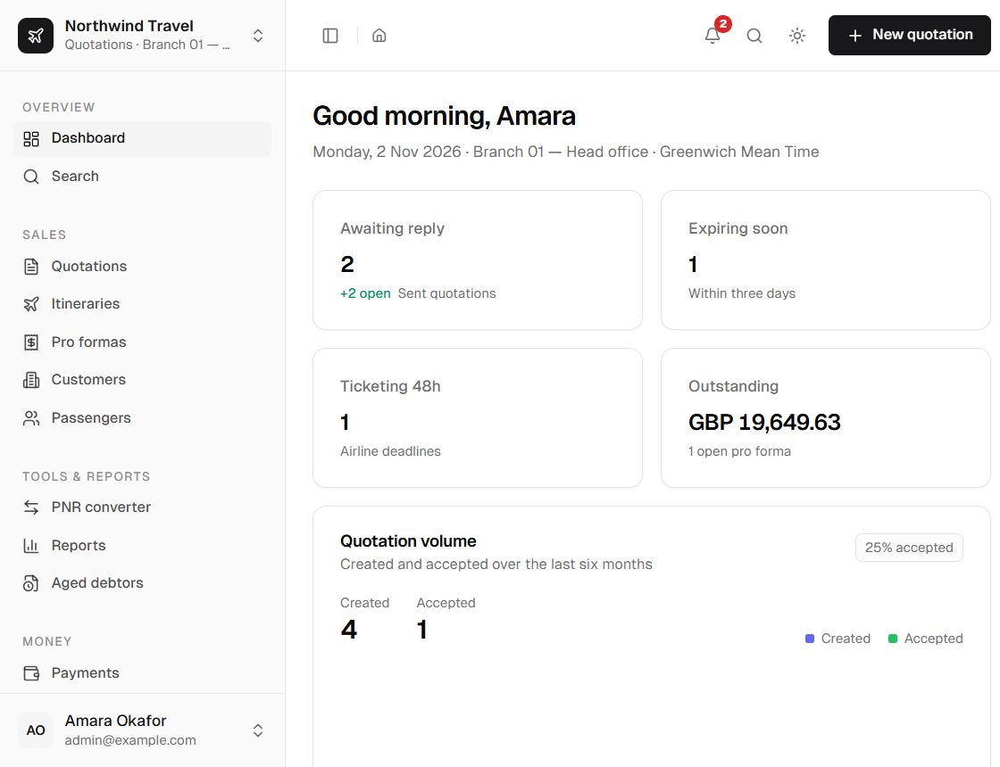
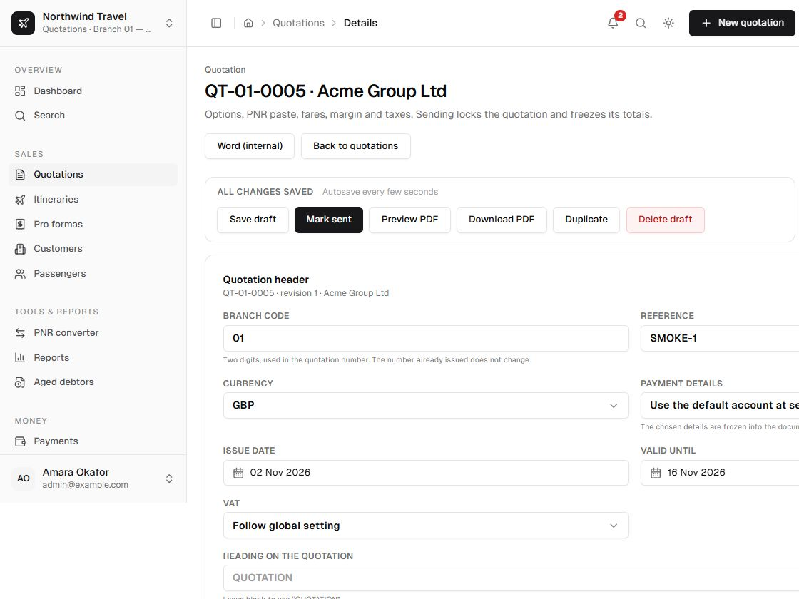
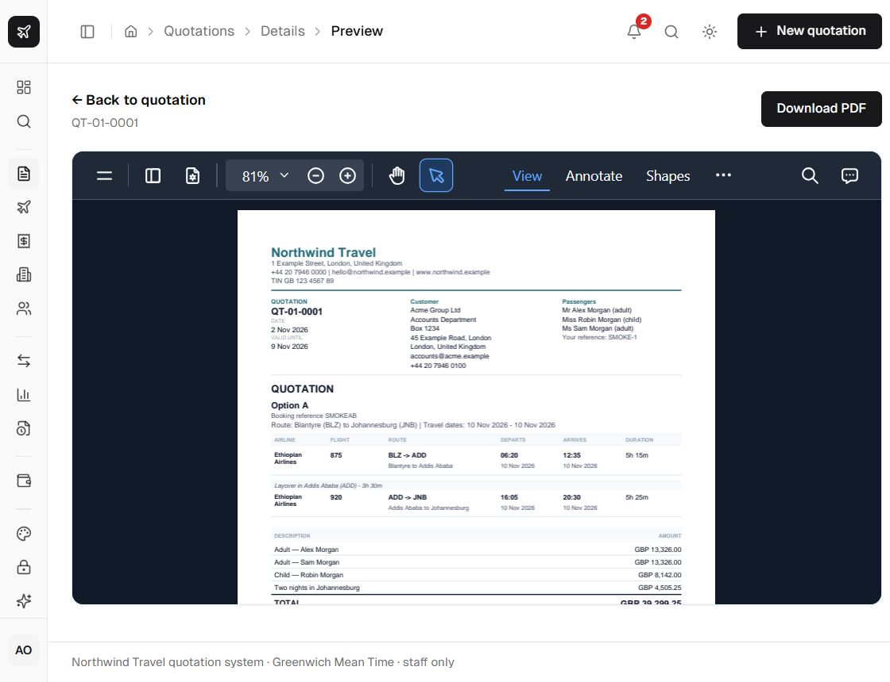

The repository includes three scripts for exploring the app with fictional data. They use the same
database as the running app, so run them only on a development installation.

<Callout type="warn" title="Not for production">
  The scripts create a fictional customer, quotation and payment records. Run them against a local
  development database only.
</Callout>

## Create a draft quotation

```bash
node scripts/smoke-quotation.mjs
```

This creates one draft quotation with two options so you can compare layouts, margins and
presentation settings. Open **Quotations** to find it.

## Advance it through the document flow

```bash
node scripts/smoke-documents.mjs
```

This accepts the option and issues an itinerary and a part-paid pro forma. Use it to check:

- the frozen quotation snapshot;
- itinerary and pro forma print layouts;
- derived payment status and the payment ledger;
- aged-debtors reporting.

## Create a viewer account

```bash
node scripts/create-viewer.mjs
```

This creates or resets `viewer@example.com` with the viewer role. Sign in as the viewer to confirm
that cost, rate, margin, VAT, profit and attachment data are removed server-side. The viewer sees
the customer-facing document and totals only.

## Reset

To start again, reset the development database and seed it:

```bash
npm run db:reset
npm run db:seed
```

`db:reset` is destructive. Never run it against a database containing real data.

## Screenshots

The documentation uses the fictional **Northwind Travel** screenshots from the repository:

<div className="docs-shot">
  
</div>

<div className="docs-shot">
  
</div>

<div className="docs-shot">
  
</div>
