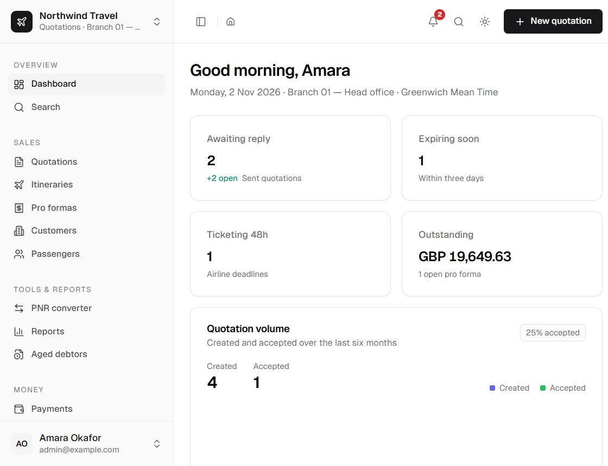

The dashboard is the staff home at `/dashboard` and opens after sign-in. The public product landing
page is `/`; it is outside the staff shell and does not show any agency data. The dashboard itself is
built live from the database on every request; nothing on it is a separately stored summary.

## What it shows

| Section | Content |
| --- | --- |
| Awaiting reply | Sent quotations, newest first, with validity dates. |
| Expiring soon | Sent quotations whose validity ends within three days. |
| Ticketing deadlines | Options whose ticketing deadline falls inside the configured warning window. |
| Outstanding | Open pro forma balances, shown only to roles with cost visibility. |
| Next follow-ups | Quotations ranked by the deterministic follow-up score. |
| Quotation volume | Created and accepted quotations over the last six months. |
| Pro forma mix | Count and value by payment status. |
| Payment methods | Receipts grouped by method. |
| Outstanding pro formas | Unpaid and part-paid balances, with the amount due. |

## Follow-up prioritisation

The follow-up score is deterministic and explainable. It starts at 20 and adds points for:

- validity already passed (+45) or ending within three days (+30) or a week (+12);
- a ticketing deadline already passed (+40) or within 48 hours (+35);
- no activity for seven days or more (up to +20);
- a planned follow-up that is due (+20).

The resulting next action is one of: confirm the trip, call about ticketing, make the planned
follow-up, send a check-in, or wait. AI is never used for ordering.

## Cost visibility

A viewer sees counts and documents but not monetary cost data. For roles without `viewCosts`, the
money cards, pro forma mix and payment-method panel are omitted, and the server does not load those
figures.

## Notifications

The bell and the **Notifications** page are derived from the same records: ticketing deadlines,
expiring quotations, overdue pro formas and due follow-ups. Nothing is stored twice. See
[search and notifications](/docs/user/guide/search-and-notifications).

  

