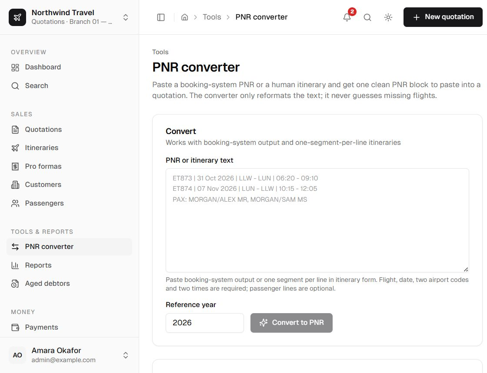

Trasper reads booking-system output and free-form itineraries into a canonical PNR shape. The
deterministic parser runs first and never invents data. Unreadable lines are reported for manual
entry. Conversion is optional: a quotation and a standalone itinerary can both be built by hand
when no booking exists.

## Where it runs

- **Quotation editor** — paste into **Import a PNR or itinerary** under an option's flights and
  choose **Read / convert**. The panel is visible by default; adding flights by hand is equally
  valid.
- **PNR converter** under **Tools → PNR converter** — convert without creating a quotation.
- **Standalone itinerary** — paste a PNR or itinerary, or add the flight rows by hand.

<div className="docs-shot">
  
</div>

## Supported input

The parser recognises Amadeus, Sabre and Galileo style segment lines, including:

```text
1  ET 873  Y 31OCT 6 LLWLUN HK1  0620 0910  31OCT  E0/332
5  ET XXX  Y 01NOV DARADD HK3  1845 2125
7  ET XXX  Y 07NOV VIEADD HK3  2230 0630+1
1 ET 873 Y 31OCT LLWLUN HK1 0620 0910
OPERATED BY EXAMPLE AIR
1 BANDA/JOHN MR
2 PHIRI/MARY MS
TK TL31OCT/1200
```

It handles:

- day-of-week digits and Galileo's shorter line shape;
- next-day arrivals (`0630+1`) and explicit Amadeus arrival dates;
- `XXX` placeholder flight numbers;
- carrier continuation lines (`OPERATED BY ...`);
- passenger names in `SURNAME/FIRSTNAME TITLE` form, including `CHD`, `CNN` and `INF` suffixes;
- ticketing deadlines in the common `TK TL`, `TKT/TIME LIMIT` and `TKTG` formats;
- missing years, using the quotation year (or the current year) as the reference.

## What the result contains

| Field | Meaning |
| --- | --- |
| `segments` | Airline, flight, origin/destination, local departure/arrival strings, cabin, operating carrier. |
| `passengers` | Title, first name, last name, adult/child/infant type. |
| `ticketingDeadline` | Local wall-clock string, or empty. |
| `unparsed` | Lines the parser did not use. |
| `warnings` | Problems worth a human check. |

## Warnings

Warnings do not block conversion. Common messages:

- no flight segments or no passenger names recognised;
- duplicate segment numbers, which can mean two PNRs were pasted;
- a segment starts where the previous one does not arrive;
- an arrival time is not after departure and no next-day marker is present;
- a placeholder flight number;
- a segment from an airport to itself (ignored).

Every new real-world parse failure should become a fixture under `src/lib/pnr/fixtures/`. The parser
must not guess; manual entry remains available.

## AI fallback

AI is limited to PNR conversion. It is used only for free-form text that the deterministic converter
cannot normalise. The flow is:

1. deterministic conversion and parsing;
2. optional AI proposal if enabled and needed;
3. Zod validation of the proposal;
4. deterministic re-parse of the final PNR text.

The provider URL, model and API key are configured under **Settings → AI**. The API key is encrypted
at rest with AES-256-GCM. Private and link-local provider URLs are blocked in production unless
`AI_ALLOW_PRIVATE_BASE_URL=1` is deliberately set.

<Callout type="info" title="No live PNR lookup">
  The converter works on pasted text only. Trasper does not connect to a GDS or airline API.
</Callout>

See [PNR formats](/docs/user/reference/pnr-formats) for the parser's exact grammar and fixture list.
