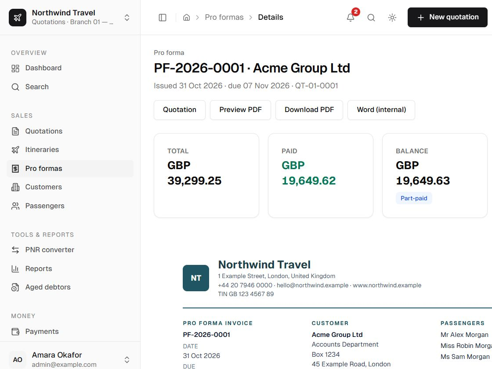

A pro forma is a request for payment before ticketing. It always comes from an **accepted quotation
option** and carries the frozen totals and customer-facing lines.

## Issue a pro forma

From an accepted quotation:

1. Choose **Create pro forma**.
2. Confirm the due date (default: 14 days after issue).
3. Edit the payment terms if needed; blank uses the standard payment terms.
4. Choose whether to show VAT explicitly.
5. Choose the bank account; the default is preselected.
6. Issue.

Rules:

- the quotation must be accepted;
- the accepted option must exist;
- only one active (non-cancelled) pro forma per quotation option is allowed; cancel the old one
  before issuing another;
- the number comes from the pro forma sequence and is never reused.

## What it contains

- Frozen customer, company and bank details.
- The customer-facing price presentation from the accepted option.
- The total and, optionally, an explicit VAT row.
- Payment terms and due date.
- Any flight summary if the agency setting enables it.
- The number and issue date.

  

## Status

The status is derived from the payment ledger:

| Condition | Status |
| --- | --- |
| No payments | Unpaid |
| Some payment, below total | Part-paid |
| Payments at or above total | Paid |
| Cancelled | Cancelled |

The scheduled job and page loads recalculate statuses, but every payment action recalculates inside
its transaction as well.

## Cancel

Cancellation requires a reason. A cancelled pro forma:

- cannot take new payments;
- cannot have payments reversed;
- remains visible for audit and reporting;
- keeps its number permanently.

## Archive and restore

A fully paid or cancelled pro forma can be archived from its page or from the list. Archiving hides
it from the active list; it does not cancel it, change its status or remove its payments. The record
remains readable, printable and part of reports and the payment ledger. Use **Archived** in the list
to find it and **Restore** to return it to the active list. An unpaid or part-paid pro forma cannot be
archived while a balance is still open, and payments cannot be reversed while the pro forma is
archived—restore it first.

## Instalments

A pro forma can carry an optional deposit-and-balance schedule: two labelled instalments with due
dates whose amounts must add up to the pro forma total. Payments are applied to the schedule
oldest-first for display. The schedule is a target only: it never changes the derived pro forma
status.

## Print and export

- On-screen A4 preview from the same frozen snapshot.
- PDF at `/api/pdf/proforma/[id]` including the payment ledger.
- Internal Word export for roles that can see costs (not a customer deliverable).

See [document lifecycle](/docs/user/reference/lifecycle) for the full freeze and cancellation rules.
