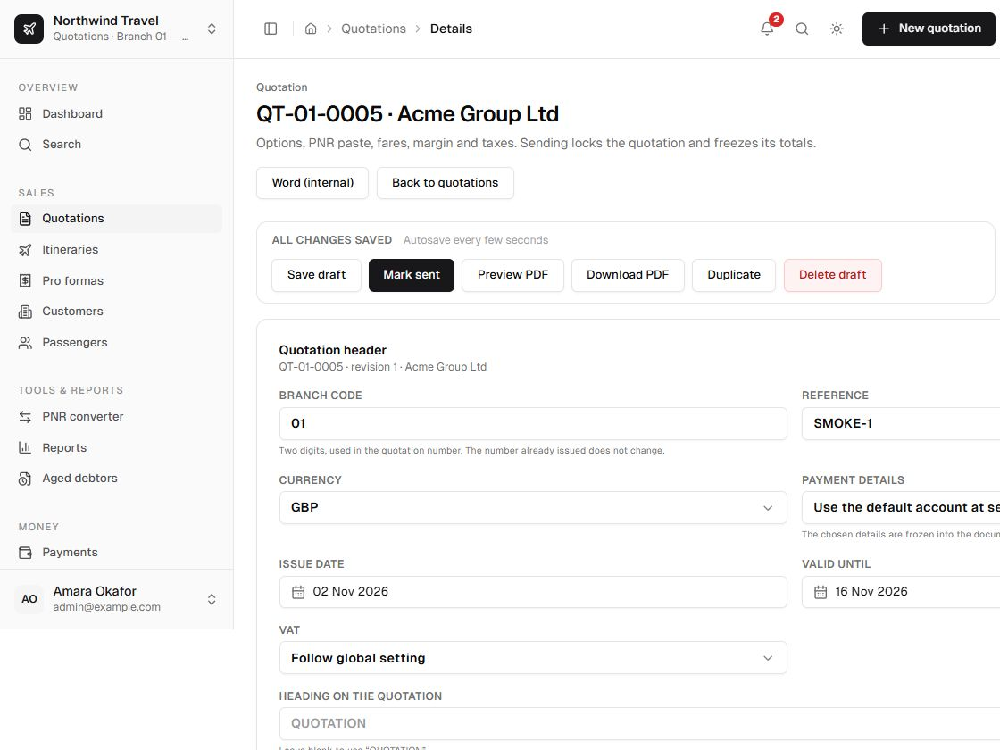
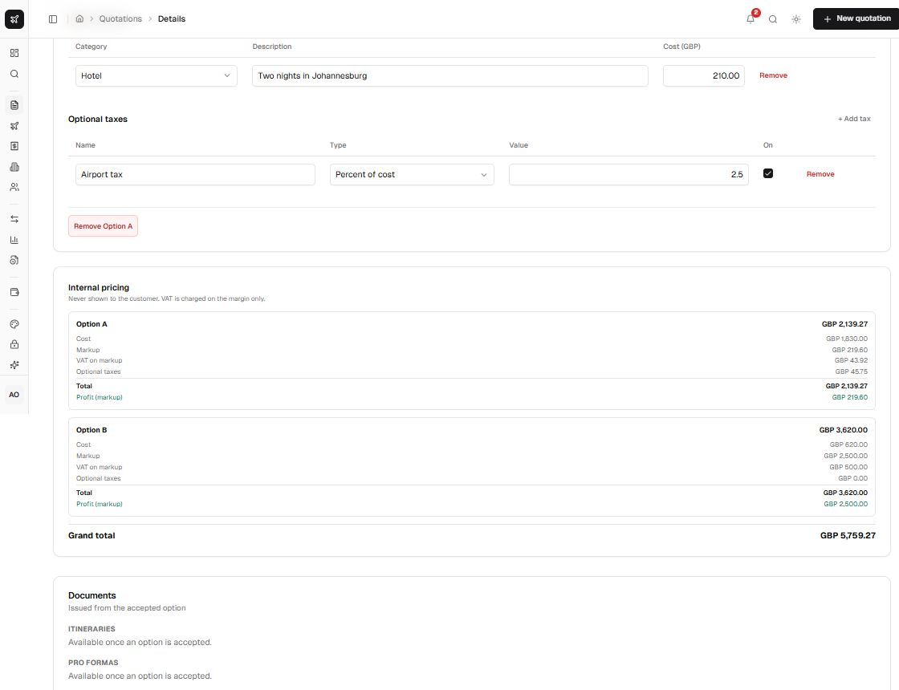

The editor is where an option becomes a priced proposal. It recalculates on the client as you type,
then the server recalculates from the same pure engine when the quotation is saved or sent.

  

## Header fields

| Field | Meaning |
| --- | --- |
| Customer | The paying contact. Archived customers cannot be used for a new send. |
| Reference | The customer's own reference, printed on documents. |
| Branch | Two-digit code used in the document number. |
| Currency | Quotation currency; all customer amounts use it. |
| Issue date / Valid until | Calendar dates, stored at UTC midnight and shown in the agency time zone. New quotations default to one day. |
| VAT | Inherit the agency default, force on, or force off for this quotation. |
| Heading | Optional printed heading above the options. |
| Notes | Customer-facing notes. Blank uses the standard quotation notes. |
| Price layout / Tax layout | Per-quotation overrides of the agency defaults. |
| Preferred pro forma account | Preselects the account for the later pro forma. Quotations never print bank details. |

The quotation also prints the agency's **Quotation validity statement** from Settings → Company. It
defaults to the 24-hour wording; the text is frozen into the snapshot when the quotation is sent.

## Options

A quotation can hold several options. Each has its own label (`Option A`, `Option B`, ...), option
type and complete pricing context.

| Field | Notes |
| --- | --- |
| Option type | Flight, accommodation, package, tour, cruise or other. Flight options require segments; land options do not. |
| PNR | Optional record locator. Shown in staff views and the itinerary. Leave it blank when you are quoting before a booking exists. |
| Ticketing deadline | Local wall-clock time at the agency; drives dashboard and notification warnings. |
| Cost currency | Currency of the supplier costs. |
| Exchange rate | Quotation currency per one cost currency, up to six decimals, stored as an integer scaled by 1,000,000. |
| Margin | Percentage of cost, or a lump sum per traveller in quotation minor units. |

### Flight segments

Each segment stores airline, flight number, origin and destination IATA codes, local departure and
arrival wall-clock times, cabin and an optional operating carrier.

Add flights with **+ Add flight**. The optional **Import a PNR or itinerary** panel reads pasted
booking-system output instead. A PNR is not required: a quotation can be built and sent before any
booking is held.

- Times are **local at each airport** and are never time-zone converted.
- `+1` arrival markers and explicit arrival dates are honoured.
- A connection warning is shown when one segment departs before the previous one arrives or when
  the airports do not connect.
- A placeholder flight number such as `XXX` is allowed but warned about.

### Fares and services

**Fares** can be recorded in two ways:

- **Named passenger** — one traveller with a name, priced individually. The same passenger cannot be
  charged twice in one option. The line reads `Adult — Name`. A draft can use any active passenger;
  passengers linked to the customer are offered first, and unlinked ones are marked **not linked**.
- **Traveller group** — a count of adults, children or infants whose names are still to be advised.
  One group per type per option, for example `2 Adults`. The cost is the **cost per traveller**, not
  the group total: the option adds unit cost × quantity. Add names directly in the group row, one
  per line, whenever they arrive; blank lines stay unnamed.

A flight option needs at least one fare, whether named or unnamed. Groups count towards the
per-person layout, so `2 Adults` divides the total by two. The markup is calculated on the
multiplied group cost, so it scales with the number of travellers.

**Services** cover hotels, visas, insurance, transfers, tours, cruises, car hire, rail, activities and
other costs. Accommodation and unit-priced services can store:

- a quantity (for example 3 nights, 2 rooms or 4 people);
- a unit (`night`, `room`, `room_night`, `person`, `person_night`, `package`, `day` or `unit`);
- an optional per-unit cost;
- details printed under the line, such as room type, board basis or supplier reference.

### Taxes

VAT is agency-wide and calculated on the **markup only**. In addition, an option can enable any
number of optional taxes. Each optional tax is:

- **fixed** (an amount in the quotation currency), or **percent** (basis points);
- charged on **cost**, **markup** (service fee) or **subtotal** (cost + markup).

See [pricing rules](/docs/user/reference/pricing) for the exact order and the line-total invariant.

## Internal pricing panel

Staff with `viewCosts` see cost, markup, VAT, optional taxes, total and profit. Profit equals the
markup; VAT is a liability, not profit. The panel also shows the rounding adjustment and warnings
about rates.

  

## Presentation

The editor can preview each customer layout:

| Layout | What the customer sees |
| --- | --- |
| Lump sum per line | One all-inclusive amount per flight or service. |
| Price plus service fee | Supplier price per line plus one labelled service fee. |
| Itemised cost, fee and taxes | Supplier cost, service fee and each tax as separate rows. |
| Per-person price | All-inclusive lines plus a per-traveller figure. |
| Single total only | One package total, no line prices. |

Tax presentation is independent: included (hidden), included with a note, taxes **not** included as
one combined row, or each tax itemised. An itemised price layout with taxes marked included is
promoted to a combined tax row so tax cannot silently disappear.

Every layout is presentation only; it must sum to the same total. See
[pricing presentation](/docs/user/administration/pricing-presentation).

## Validation before sending

Errors block sending:

- no segments on a flight option;
- no fares or services at all;
- no fare on a flight option;
- exchange rate zero or missing;
- missing percentage margin;
- the same passenger twice, or two unnamed groups of the same traveller type;
- a traveller group with no travellers;
- negative fare, service or tax amounts.

Warnings allow sending:

- an infant without an adult;
- a placeholder `XXX` flight number;
- a broken connection or a segment departing before the previous arrival;
- a zero fare (requires explicit confirmation);
- a negative margin (administrator only, with a reason).

Sending also verifies that every foreign cost currency has a saved exchange rate. Old rates outside
the configured maximum age are reported as warnings.

## Saving and locking

- Saves use optimistic locking: a stale editor gets a message instead of overwriting another user's
  change.
- A sent quotation is locked. Use **Revise** to create the next revision; do not attempt to edit a
  sent record.
- Every save, send, accept, decline, cancel and revision writes an audit entry in the same
  transaction as the change.
