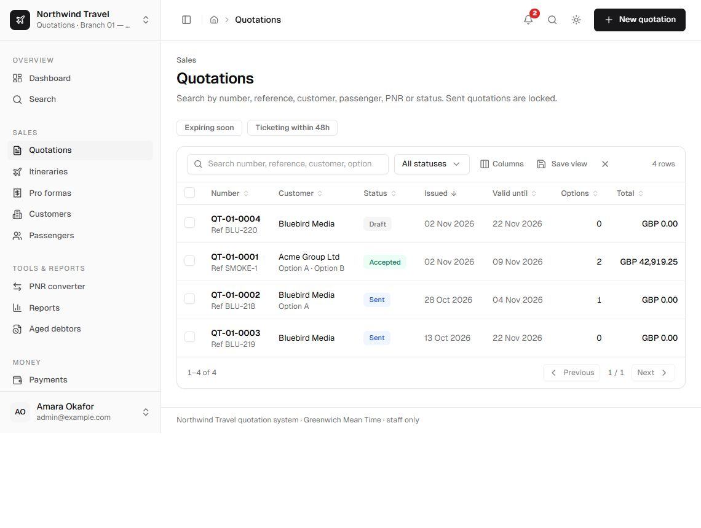
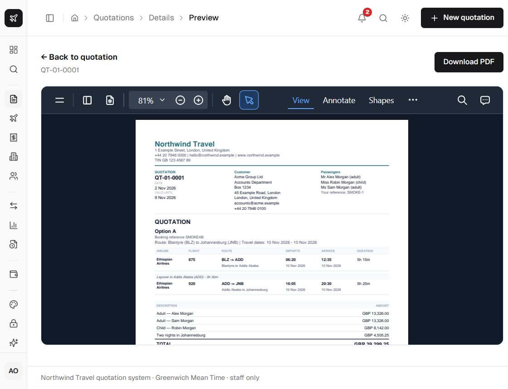

The quotation list is the working queue. It shows every revision and lets you search by number,
reference, customer, passenger, PNR or status.

  

## Filters and saved views

- Full-text search across numbers, references, customers, passengers and PNRs.
- Status filters: draft, sent, accepted, declined, expired, cancelled, superseded.
- Quick filters for **expiring** and **ticketing deadline**.
- Column visibility, sorting and a saved per-user table view for the list.
- Bulk actions for duplicating or cancelling selected quotations.
- CSV export of the selected rows.

Saved views are stored per user in `SavedTableView`; they never change what another user sees.

## Row actions

| Action | Availability | Effect |
| --- | --- | --- |
| Open | Any visible quotation | Opens the editor or the read-only customer view. |
| Duplicate | Manage quotations | Creates a new draft copy with new numbers. |
| Revise | Any non-draft quotation | Creates the next revision and supersedes the old record. |
| Cancel | A draft or sent quotation | Cancels with a reason; the number is never reused. |
| Delete | An unsent draft with no issued documents | Permanently removes the draft and audits it. |

## Status meanings

- **Draft** — editable. No snapshot exists yet.
- **Sent** — locked; totals, company profile and bank details are frozen.
- **Accepted** — the customer chose an option. Documents can be issued.
- **Declined** — the customer said no.
- **Expired** — the validity date passed; the scheduled job or a page load applies it.
- **Cancelled** — cancelled with a reason before acceptance. The record and number are kept.
- **Superseded** — replaced by a revision. Kept for history.

## Revisions

**Revise** copies the quotation and all its options into a new draft, increments the revision and
marks the old record `superseded`. The number keeps its base and gains `-R2`, `-R3` and so on. The
old revision remains viewable and auditable.

## Revision comparison

Open **Compare revisions** on a revised quotation (or its predecessor) for a side-by-side view of
the frozen snapshots. The screen highlights added, removed and changed options, lines and flights,
plus changed totals, PNRs and deadlines. It is presentation-only: it never recalculates money. Cost,
markup and VAT columns are hidden for roles without `viewCosts`.

## Cancellation

Cancellation requires a reason. It does not delete the document or release its number. Drafts and
sent quotations can be cancelled by an agent. An accepted quotation can also be cancelled, but only
by an administrator: open the quotation and use **Cancel accepted quotation** in the **Accepted**
panel. Issued itineraries and pro formas are not cancelled automatically and payments must be
reversed separately. Declined, expired and superseded quotations cannot be cancelled. A revision of
a cancelled quotation is allowed and creates a new draft.

## Read-only view

Roles that cannot see costs get the customer-facing presentation only. The customer-facing preview
uses the frozen snapshot for sent/issued records and the live calculation for drafts. The PDF route
consumes the same snapshot and template id, so the content cannot diverge even though the PDF is
drawn with `pdf-lib` rather than HTML.

## Preview and PDF

Open a quotation and use **Preview** for the full document. The toolbar offers:

- on-screen A4 preview;
- PDF download or inline preview from `/api/pdf/quotation/[id]`;
- internal Word export for roles that can see costs (not a customer deliverable).

  

